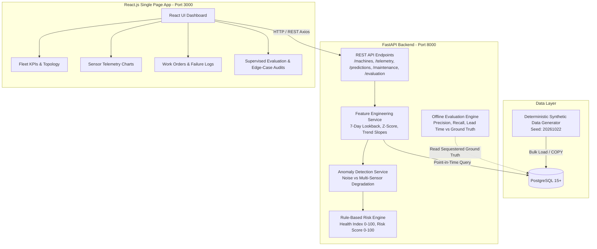

# System Architecture

This document describes the high-level architecture, components, and data flow of the Industrial Predictive Maintenance System.

---

## 1. High-Level Architecture Diagram

---

## 2. Core Components

### 2.1 React Frontend (`/frontend`)
- Built with React 18, React Router, Recharts, and Lucide icons.
- Displays fleet health status, machine topology, 5-channel time-series telemetry charts, maintenance work orders, model evaluation metrics, and data quality audits.
- Communicates with the backend exclusively via standard HTTP REST requests.

### 2.2 FastAPI Backend (`/backend`)
- High-performance asynchronous REST API built with FastAPI and Python 3.11+.
- Organized into clean modular layers:
  - **Routes (`backend/routes/`)**: Request validation, response serialization, and endpoint routing.
  - **Services (`backend/services/`)**: Feature extraction, anomaly detection, risk scoring, and evaluation logic.
  - **Models (`backend/models/`)**: SQLAlchemy ORM definitions for relational tables.
  - **Validators (`backend/validators/`)**: Input sanity guards and edge-case detection.

### 2.3 PostgreSQL Database
- Relational store holding master data (plants, lines, machines, sensors), transactional telemetry readings, operating shifts, spare parts, technicians, and maintenance logs.
- Utilizes composite B-tree indexing on `(sensor_id, recorded_at)` to support fast point-in-time time-series queries.

### 2.4 Synthetic Data Generation (`backend/generators/`)
- Deterministic industrial simulator driven by a fixed seed (`20261022`).
- Generates 90 days of 30-minute sensor telemetry (2.16 million records) for 100 machines and 500 sensors.
- Injects operational shifts, ambient diurnal thermal cycles, progressive mechanical wear (Type A), and sudden stochastic breakdowns (Type B).

### 2.5 Feature Engineering (`backend/services/feature_engineering.py`)
- Calculates statistical indicators over a 7-day lookback window:
  - Rolling mean, standard deviation, and Z-score per sensor.
  - Linear trend slope (rate of drift).
  - Multi-sensor cross-channel aggregates.
- **Anti-Leakage Guarantee:** Strictly queries telemetry where `recorded_at < prediction_timestamp`. No future data or failure records are exposed to features.

### 2.6 Anomaly Detection & Rule-Based Risk Engine (`backend/services/risk_engine.py`)
- Distinguishes isolated sensor noise from systemic mechanical failure:
  - **Isolated Anomaly:** A spike on a single sensor channel without correlation is capped at Risk Score 30.0 (Normal) and flagged for sensor calibration inspection.
  - **Correlated Degradation:** Anomalies detected simultaneously across 2 or more related physical channels (e.g., vibration + temperature) escalate the risk score (Warning: $\ge 35$, Critical: $\ge 65$).
- **Health Index:** Derived as `Health Index = 100.0 - Risk Score`.
- **RUL Status:** Remaining Useful Life is transparently marked uncalibrated (`None`) rather than returning unverified machine learning estimates.

### 2.7 Supervised Evaluation (`backend/services/offline_evaluator.py`)
- Compares risk warnings generated across historical time windows against sequestered ground-truth failure records.
- Computes precision, recall, F1-score, and average warning lead time for progressive degradation vs sudden failures.

---

## 3. End-to-End Data Flow

1. **Telemetry Ingestion & Storage:** Sensor telemetry is stored in PostgreSQL with indexed timestamps and quality status tags (`normal`, `sensor_fault`, `invalid`, `missing`).
2. **Point-in-Time Request:** When a user or system evaluates a machine at time $T$, the backend queries sensor observations strictly up to $T$.
3. **Feature Calculation:** The feature pipeline computes rolling means, standard deviations, and Z-scores for each mounted sensor channel.
4. **Multi-Sensor Rule Evaluation:** The risk engine checks whether anomalies appear in isolation (instrumentation fault) or across multiple sensors (physical degradation).
5. **Score & Recommendation Delivery:** The backend returns an explainable health index, risk score, contributing sensor signals, and recommended maintenance action to the React frontend.
