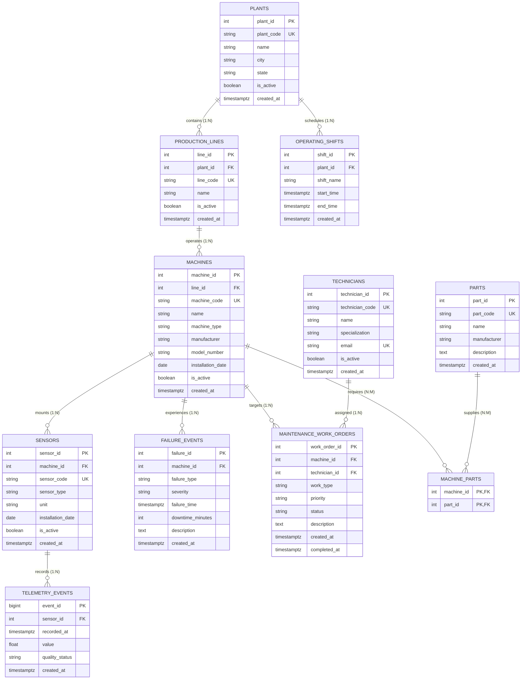

# Database Schema & Entity Relationships

This document details the PostgreSQL relational schema, entity relationships, primary/foreign keys, and cardinalities implemented across the 10 core tables and 1 bridge table.

---

## 1. Entity-Relationship Diagram

---

## 2. Core Entities (10 Relational Models)

| # | Entity Name | Table Name | SQLAlchemy Model File | Primary Key | Description |
| :- | :--- | :--- | :--- | :--- | :--- |
| 1 | **Plant** | `plants` | `backend/models/plant.py` | `plant_id` (Integer) | Manufacturing factory sites (Pune, Chennai, Ahmedabad). |
| 2 | **ProductionLine** | `production_lines` | `backend/models/production_line.py` | `line_id` (Integer) | Manufacturing lines situated within a plant. |
| 3 | **Machine** | `machines` | `backend/models/machine.py` | `machine_id` (Integer) | Industrial equipment assets (mills, pumps, compressors, etc.). |
| 4 | **Sensor** | `sensors` | `backend/models/sensor.py` | `sensor_id` (Integer) | Attached IoT sensors (Vibration, Temperature, Acoustic, etc.). |
| 5 | **TelemetryEvent** | `telemetry_events` | `backend/models/telemetry_event.py` | `event_id` (BigInteger) | High-volume time-series telemetry measurements. |
| 6 | **OperatingShift** | `operating_shifts` | `backend/models/operating_shift.py` | `shift_id` (Integer) | Daily operational shifts per plant with explicit schedule windows. |
| 7 | **MaintenanceWorkOrder** | `maintenance_work_orders` | `backend/models/maintenance_work_order.py` | `work_order_id` (Integer) | Corrective and preventive maintenance work tasks. |
| 8 | **FailureEvent** | `failure_events` | `backend/models/failure_event.py` | `failure_id` (Integer) | Historical equipment failure incidents with downtime logs. |
| 9 | **Part** | `parts` | `backend/models/part.py` | `part_id` (Integer) | Spare parts and replaceable components catalog. |
| 10 | **Technician** | `technicians` | `backend/models/technician.py` | `technician_id` (Integer) | Certified plant maintenance engineers. |

---

## 3. Relationships and Cardinality

### 3.1 One-to-Many (1:N) Hierarchies

1. **`Plant` $\rightarrow$ `ProductionLine` (1:N):**
   - Each plant hosts multiple production lines (`plants.plant_id = production_lines.plant_id`).
   - Cascade delete: Removing a plant removes its associated lines.

2. **`Plant` $\rightarrow$ `OperatingShift` (1:N):**
   - Each plant defines recurring operating shifts (`plants.plant_id = operating_shifts.plant_id`).
   - Preserves schedule history; deletion restricted (`ondelete="RESTRICT"`).

3. **`ProductionLine` $\rightarrow$ `Machine` (1:N):**
   - A production line operates multiple machines (`production_lines.line_id = machines.line_id`).
   - Cascade delete: Removing a line cascades to machine records.

4. **`Machine` $\rightarrow$ `Sensor` (1:N):**
   - Each machine has multiple physical sensor probes (`machines.machine_id = sensors.machine_id`).
   - In this dataset, each machine mounts 5 standard sensor channels (`Vibration`, `Temperature`, `Acoustic`, `Pressure`, `Current`).
   - Cascade delete: Removing a machine deletes its sensor records.

5. **`Sensor` $\rightarrow$ `TelemetryEvent` (1:N):**
   - Each sensor produces time-series measurements (`sensors.sensor_id = telemetry_events.sensor_id`).
   - Deletion restricted (`ondelete="RESTRICT"`) to safeguard historical time-series data.

6. **`Machine` $\rightarrow$ `MaintenanceWorkOrder` (1:N):**
   - Multiple work orders may target a single machine over its operational lifecycle.
   - Deletion restricted (`ondelete="RESTRICT"`).

7. **`Technician` $\rightarrow$ `MaintenanceWorkOrder` (1:N):**
   - Technicians can be assigned to multiple work orders (`technicians.technician_id = maintenance_work_orders.technician_id`).
   - Nullable foreign key (`ondelete="SET NULL"` allows unassigned orders).

8. **`Machine` $\rightarrow$ `FailureEvent` (1:N):**
   - A machine may record zero, one, or multiple breakdown events (`machines.machine_id = failure_events.machine_id`).
   - Deletion restricted (`ondelete="RESTRICT"`).

### 3.2 Many-to-Many (N:M) Relationship

- **`Machine` $\leftrightarrow$ `Part` (`machine_parts` Bridge Table):**
  - Connects compatible replacement components to machine models.
  - Defined in `backend/models/part.py` using composite primary key: `(machine_id, part_id)`.
  - Both foreign keys cascade on deletion (`ondelete="CASCADE"`).

---

## 4. Key Constraints and Indexing Strategy

- **Unique Business Codes:** Enforced on `plant_code`, `line_code`, `machine_code`, `sensor_code`, `part_code`, and `technician_code`.
- **Time-Series Query Optimization:**
  - Composite B-tree index `ix_telemetry_events_sensor_recorded` on `(sensor_id, recorded_at)` enables rapid lookups for the 7-day feature calculation window.
  - Dedicated index on `telemetry_events.recorded_at` facilitates global temporal point-in-time filtering.
- **Incident History Indexing:**
  - Index on `failure_events.failure_time` allows fast temporal matching for evaluation lead-time auditing.
  - Index on `maintenance_work_orders.status` accelerates active work order filtering in operational views.
